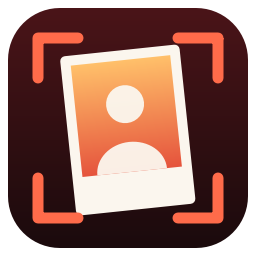

<p align="center"></p>

<h1 align="center">Revelador</h1>

<p align="center">Escolha as fotos, confira o enquadramento no tamanho do papel e separe tudo para a revelação.</p>

<p align="center">
  <a href="https://github.com/edvitor13/revelador/releases/latest">Baixar a versão mais recente</a> ·
  <a href="CHANGELOG.md">O que mudou</a>
</p>

---

## Por que

Foto de celular é 4:3, 16:9 ou quadrada; o papel 10x15 é 2:3, o 13x18 é 5:7, o 20x25 é 4:5. Quando a foto vai
assim para o laboratório, a máquina corta o que sobra pelo meio — e às vezes leva junto uma cabeça ou a pessoa da
ponta. O Revelador mostra **exatamente o que vai sair no papel**, sugere um corte que **preserva os rostos** e
deixa você ajustar antes de enviar. Se preferir não cortar nada, ele põe a **foto inteira** no papel, com a cor de
fundo que você escolher.

## O que ele faz

**Escolher**
- **Importar** fotos e pastas (JPEG, PNG, HEIC do iPhone, WebP, TIFF), com a orientação e a cor certas; arrastar
  para a janela também funciona. A foto importada já entra marcada no tamanho padrão.
- **Tamanho e cópias** para cada foto (10x15, 13x18, 15x20, 15x21, 20x25, 20x30, A4, 30x40, 30x45, 40x60,
  quadradas e personalizado), com − e + direto na grade; uma foto pode sair em vários tamanhos, cada um com o
  seu enquadramento. Um tamanho pode ficar com **0 cópias** para ser guardado sem ir para a revelação.
- **Pastas de tamanho**: grupos como "Família 15x21" para organizar o pedido e a exportação.
- **Favoritas** com estrela e **filtros** na grade: por pasta, por tamanho, favoritas, com mais de uma cópia,
  sem pasta e **repetidas** (fotos muito parecidas em arquivos diferentes, lado a lado, para comparar e unificar).

**Enquadrar**
- **Enquadramento automático centrado nos rostos**, na proporção exata do papel, com aviso de resolução baixa.
- **Editor**: mover, aproximar e afastar (alças nos cantos), girar 90°, **espelhar** na horizontal e na vertical,
  endireitar, centralizar e a margem de corte do laboratório. Afastar além da foto aumenta o papel com uma **cor de
  fundo** (branco, preto ou qualquer cor), e o botão **Foto inteira** ajusta a foto toda no papel com um clique.
- **Visualizar**: passa pelas fotos marcadas mostrando o resultado de cada tamanho, com as cópias e o recorte de
  cada um, em tela cheia se quiser.

**Ajustar e enviar**
- **Ajustes no painel lateral**: exposição, contraste, realces, sombras, brancos, pretos, temperatura, matiz,
  saturação, vibração e nitidez, com antes/depois e copiar/colar entre fotos.
- **Exportar para revelação**: uma pasta por tamanho (ou por pasta de tamanho), JPEG sRGB a 300 dpi com os pixels
  exatos do papel e um resumo do pedido para o laboratório. As fotos originais nunca são alteradas.
- **Previsão de custos**: cadastre o valor de cada tamanho no seu laboratório e veja o total estimado do pedido.

**Trabalhar com calma**
- **Salvamento automático** a cada minuto, desfazer/refazer de tudo e recuperação depois de uma falha.
- **Continuar de onde parou**: o trabalho reabre na última foto em que você estava.
- **Tela de boas-vindas** com os trabalhos recentes e as novidades, e **atualização automática**.

Tudo roda no seu computador: nenhuma foto é enviada para lugar nenhum.

## Instalar

Baixe em [Releases](https://github.com/edvitor13/revelador/releases/latest):

- `Revelador-vX.Y.Z-windows-x64.msi` — instalador (por usuário, sem pedir administrador; atualiza sozinho);
- `Revelador-vX.Y.Z-windows-x64.zip` — versão portátil.

O `SHA256SUMS.txt` da release confere os arquivos. Windows 10 ou 11 (64 bits).

## Versões

| Versão | Data | Destaques |
|---|---|---|
| [0.2.2](https://github.com/edvitor13/revelador/releases/tag/v0.2.2) | 2026-11-17 | Enquadramento próprio de cada tamanho, 0 cópias, repetidas lado a lado |
| [0.2.1](https://github.com/edvitor13/revelador/releases/tag/v0.2.1) | 2026-11-15 | Espelhar a foto na horizontal e na vertical |
| [0.2.0](https://github.com/edvitor13/revelador/releases/tag/v0.2.0) | 2026-11-15 | Foto inteira com cor de fundo, favoritas, continuar de onde parou, Visualizar em tela cheia |
| [0.1.1](https://github.com/edvitor13/revelador/releases/tag/v0.1.1) | 2026-11-03 | Filtros de cópias e repetidas, comparar repetidas na tela grande |
| [0.1.0](https://github.com/edvitor13/revelador/releases/tag/v0.1.0) | 2026-11-03 | Primeira versão |

Os detalhes de cada uma estão no [CHANGELOG](CHANGELOG.md). Trabalhos (`.revelador`) salvos numa versão abrem nas
outras: o que uma versão anterior não conhece ela ignora.

## Desenvolvimento

```bat
instalar.bat                              :: cria o .venv (Python 3.15) e instala as dependências
executar.bat                              :: abre o app
.venv\Scripts\python -m pytest -q         :: testes
build.bat                                 :: executável, .zip e (com o WiX) .msi
```

Antes de mexer no código, leia o [AGENTS.md](AGENTS.md) (regras, mapa e receitas) e a
[arquitetura](docs/ARQUITETURA.md). O CI (GitHub Actions) roda os testes em todo push e, no `main`, gera e testa o
instalador; uma tag `vX.Y.Z` publica a release.

## Licença

[MIT](LICENSE) © 2026 Vitor Gabriel. O modelo de detecção de rostos YuNet (OpenCV Zoo) é distribuído sob a licença
MIT.
